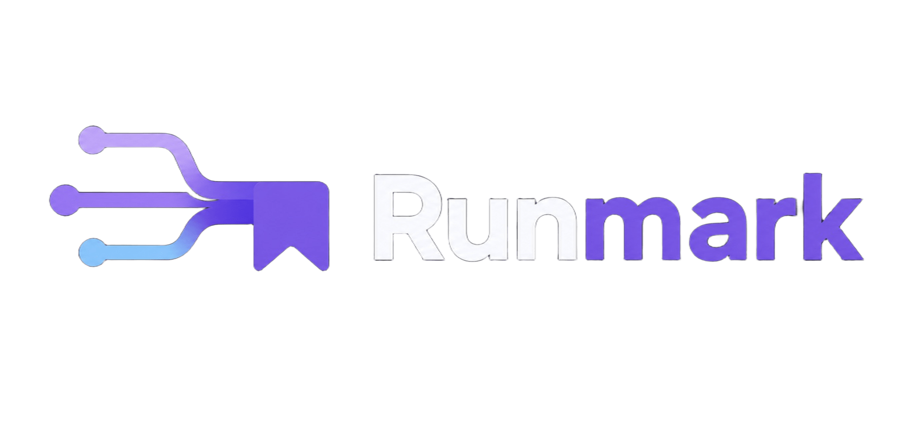
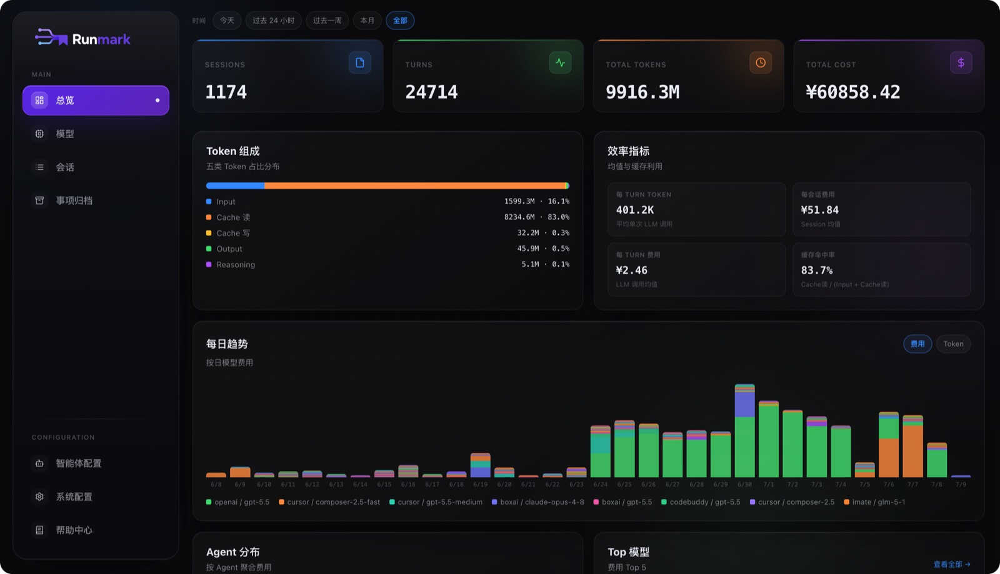
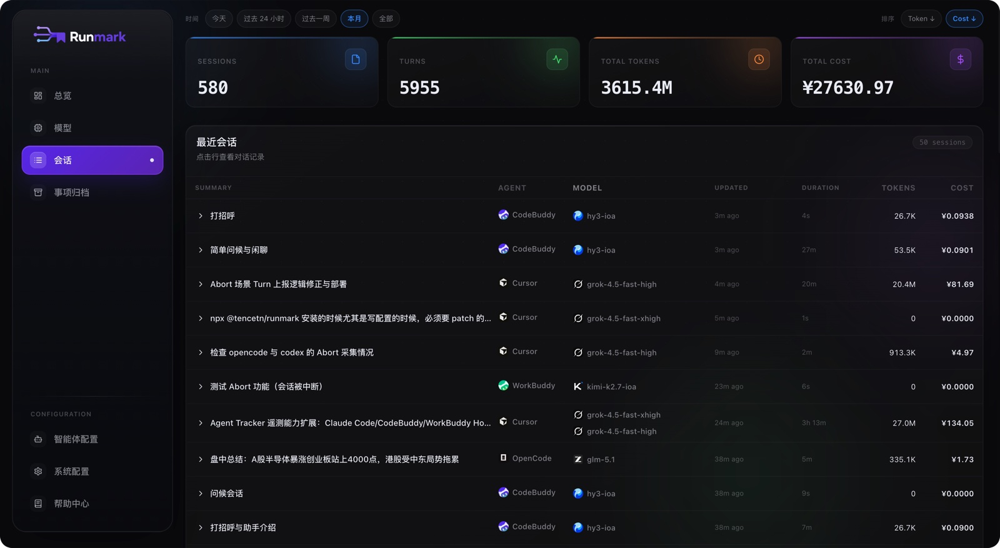
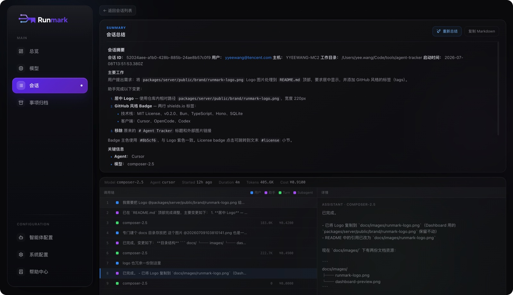
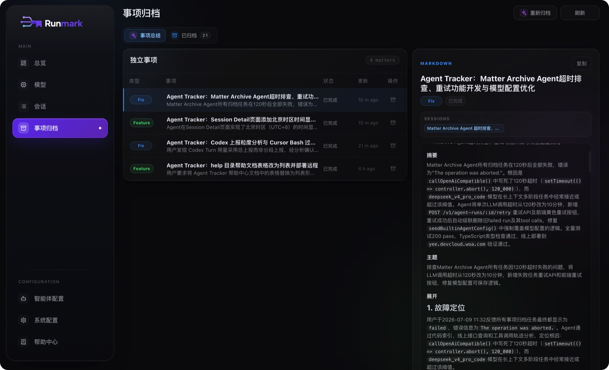

<p align="center">
  
</p>

<p align="center">
  <a href="https://www.typescriptlang.org/"></a>
  <a href="LICENSE"></a>
  <a href="https://www.npmjs.com/package/@runmarks/runmark"></a>
  <a href="https://www.npmjs.com/package/@runmarks/runmark"></a>
  <a href="https://github.com/yee94/runmark/actions/workflows/ci.yml"></a>
  <a href="https://bun.sh"></a>
</p>

<p align="center">
  <strong>Runmark</strong> — Centralize every AI coding conversation — from Codex on one machine, Claude Code on another — into a single place for analysis, search, and cost insight.
</p>

<p align="center">
  <a href="README_ZH.md">中文</a> · <a href="LICENSE">MIT License</a>
</p>

### ✨ Features

- 📡 **Unified collection & review** — Aggregates sessions from Cursor, OpenCode, Codex, Claude Code, CodeBuddy, WorkBuddy, Grok Build and other AI coding clients into one place. Review usage, cost, and full conversation content across all your machines.
- 📝 **AI-powered summaries** — Automatically summarizes your AI conversations, so you can quickly see what was done and keep handoff notes up to date.
- 🔗 **Open API & SDK** — Standard ingest and query APIs let you plug Runmark into any agent or automation workflow.
- 📊 **Usage & cost insight** — Aggregates tokens, cost, model, and client distribution over today / this week / this month windows, so you always know where the money goes.
- 📋 **Matter archive** — Persists work outcomes and handoff-able items across sessions. Focus on "what was done" instead of scrolling through sessions.
- 🔍 **Call-chain tracing** — A dense trace view that walks back through the messages, reasoning turns, and tool calls of a single conversation.
- 💰 **Cursor billing sync** — Integrates the Cursor Usage API and reconciles it against local telemetry for an official billing perspective.
- 🤖 **Configurable agents** — Custom triggers (throttle on new conversations, scheduled CRON) run background jobs like summary and archiving automatically.
- 🚀 **One-command deploy** — `setup.sh` handles service install, auth, and client configuration; the Dashboard ships a built-in help center.

<table align="center" width="100%">
  <tr>
    <td width="25%" align="center" valign="top">
      
      <br /><sub>Overview</sub>
    </td>
    <td width="25%" align="center" valign="top">
      
      <br /><sub>Session list</sub>
    </td>
    <td width="25%" align="center" valign="top">
      
      <br /><sub>Session summary</sub>
    </td>
    <td width="25%" align="center" valign="top">
      
      <br /><sub>Matter archive</sub>
    </td>
  </tr>
</table>

## Architecture

```text
[Cursor Hook]        ─┐
[OpenCode Plugin]    ─┤
[Codex Hook Plugin]  ─┤
[Claude Code Plugin] ─┼─ POST /v1/ingest ─▶ [Runmark Server] ─▶ [Dashboard]
[CodeBuddy Plugin]   ─┤
[WorkBuddy Plugin]   ─┤
[Grok Build Hooks]   ─┘
```

## Quick Start

Two steps: **deploy the server first**, then **install the client plugins** on each machine. Per-product instructions and troubleshooting live in the Dashboard help center: `http://<server-address>:3456/#/help`.

### 1. Deploy the server

#### Recommended: let an AI do it for you

Paste the prompt below into Cursor / OpenCode / Codex (or any agent), filling in your SSH command or local path:

```text
Please deploy Runmark for me.

Target environment:
- This machine / remote server (if remote, give the SSH connection command)

Strictly follow skills/agent-tracker-setup/SKILL.md in this repo:
1. If remote, SSH into the target machine first
2. Run ./setup.sh --server per the "Server deployment" section
3. Verify /health with curl
4. Report back the Dashboard URL, API Key, and help center URL

Do not install client plugins on this machine; after deployment point me to the Dashboard help center or the README "Install clients" section.
```

Skill: [skills/agent-tracker-setup/SKILL.md](skills/agent-tracker-setup/SKILL.md)

Docker deployment is also supported. Image build, volumes, env vars, and upgrade flow: see [Docker deployment guide](docs/docker.md).

<details>
<summary><strong>Manual server deployment (expand)</strong></summary>

#### Deploy the service

On the target machine:

```bash
git clone https://github.com/yee94/runmark.git /opt/agent-tracker
cd /opt/agent-tracker
./setup.sh --server
```

`--server` performs: preflight checks → install dependencies → init SQLite → generate `.env` → register systemd → start the service.

The terminal prints the **Dashboard URL** and **API Key** (which also acts as the login password). Verify:

```bash
curl http://<server-address>:3456/health
```

A `{"status":"ok",...}` response means it works.

#### Local development

```bash
git clone https://github.com/yee94/runmark.git
cd runmark
./setup.sh
```

Or manually:

```bash
bun install
cd packages/server
bun dev
```

Dashboard: `http://localhost:3456/`. The script is idempotent — rerunning never overwrites existing config.

</details>

### 2. Install clients

Once the server is up, install the plugins on each machine: Cursor / OpenCode / Codex / Claude Code / CodeBuddy / WorkBuddy / Grok Build. The unified entry point is the `@runmarks/runmark` package.

#### Option A: let an AI read the Skill (recommended)

Paste this prompt into your local agent (Cursor / OpenCode / Codex etc.), filling in your Dashboard address and API Key:

```text
Please install the Runmark client plugins on this machine.

Server:
- Dashboard / endpoint: http://<server-address>:3456
- API Key: <server API key>

Strictly follow skills/agent-tracker-clients/SKILL.md in this repo:
1. List the available clients (Cursor / OpenCode / Codex / Claude Code / CodeBuddy / WorkBuddy / Grok Build) and let me pick; do not default to all
2. Write or verify ~/.config/agent-tracker/env (endpoint + apiKey)
3. Install via the unified entry: npx @runmarks/runmark --clients <my selection>
4. Tell me which clients need a restart and how to verify on the Dashboard
```

Skill: [skills/agent-tracker-clients/SKILL.md](skills/agent-tracker-clients/SKILL.md)

#### Option B: manual install

1. Write the unified config (required for new installs; if the file exists, verify — don't blindly overwrite):

```bash
mkdir -p ~/.config/agent-tracker
cat > ~/.config/agent-tracker/env << 'EOF'
export AGENT_TRACKER_ENDPOINT="http://<server-address>:3456"
export AGENT_TRACKER_API_KEY="<server API key>"
EOF
```

2. Install with the brand package:

```bash
# Interactive install (recommended): auto-detects; rerunning preselects and updates installed clients
npx @runmarks/runmark

# Update only installed Runmark clients (non-interactive)
npx @runmarks/runmark --clients installed
# or: npx @runmarks/runmark --yes

# Install everything / on demand
npx @runmarks/runmark --clients all
npx @runmarks/runmark --clients cursor,codex,workbuddy

# Uninstall example
npx @runmarks/runmark --clients codebuddy --uninstall
```

If `npx @runmarks/runmark` reports `command not found`, use:

```bash
npx -p @runmarks/runmark runmark
# or: bunx @runmarks/runmark
```

3. **Restart** the installed clients (Claude / CodeBuddy / WorkBuddy support `/reload-plugins`; Grok Build just needs a new session). If Codex / Claude-family prompts for trust, review and trust the Runmark plugin hooks in the app.

4. Open the Dashboard sessions page and confirm `agent=cursor|opencode|codex|claude|codebuddy|workbuddy|grok`.

Available clients: `cursor` · `opencode` · `codex` · `claude` · `codebuddy` · `workbuddy` · `grok` · `all` · `installed` · `detected`. With no arguments it auto-detects and prompts interactively (preselecting and updating what's already installed).

## Development

```bash
bun install
bun test
```

Key packages:

- `packages/runmark` — unified install entry point `@runmarks/runmark`
- `packages/server` — Bun + Hono + SQLite server and Dashboard
- `packages/plugin-opencode` — OpenCode plugin
- `packages/plugin-codex` — Codex hook plugin
- `packages/plugin-claude-compat` — Plugin Marketplace package for Claude Code / CodeBuddy / WorkBuddy (product selected via `--runtime`; idempotent `npx` upgrades)
- `packages/plugin-grok` — Grok Build user-level hooks plugin (`~/.grok/hooks`, reads local sessions on Stop)
- `packages/hook-cursor` — Cursor hook
- `shared` — shared types, pricing, and utilities
- `skills/agent-tracker-setup` / `skills/agent-tracker-clients` — server deploy / client install skills

## License

[MIT](LICENSE)
